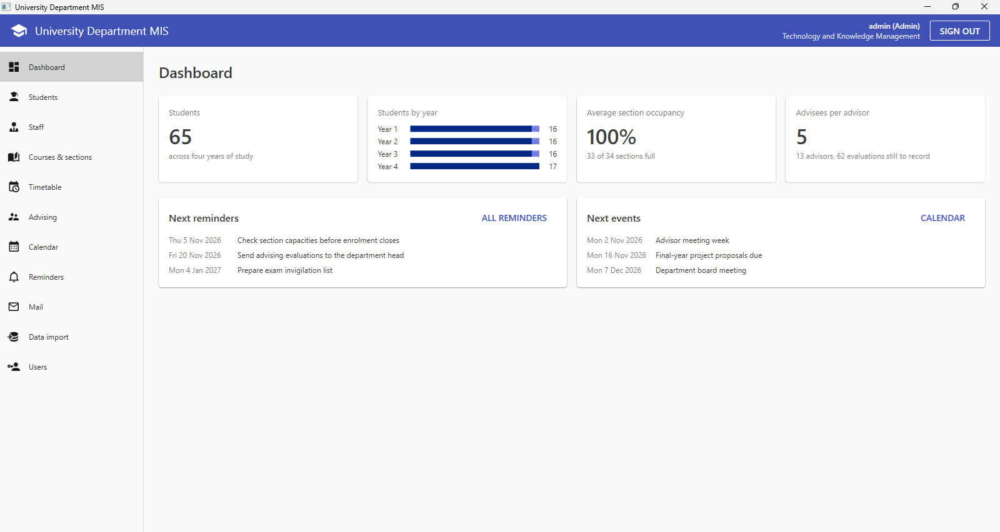
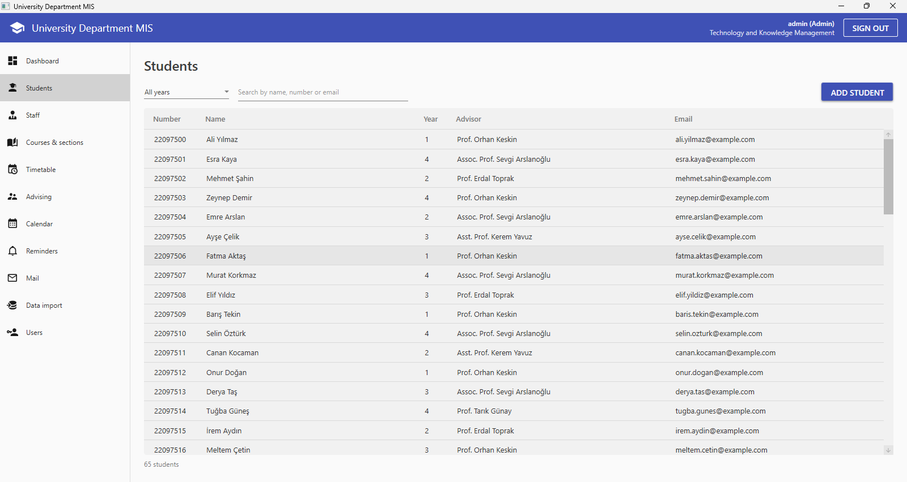
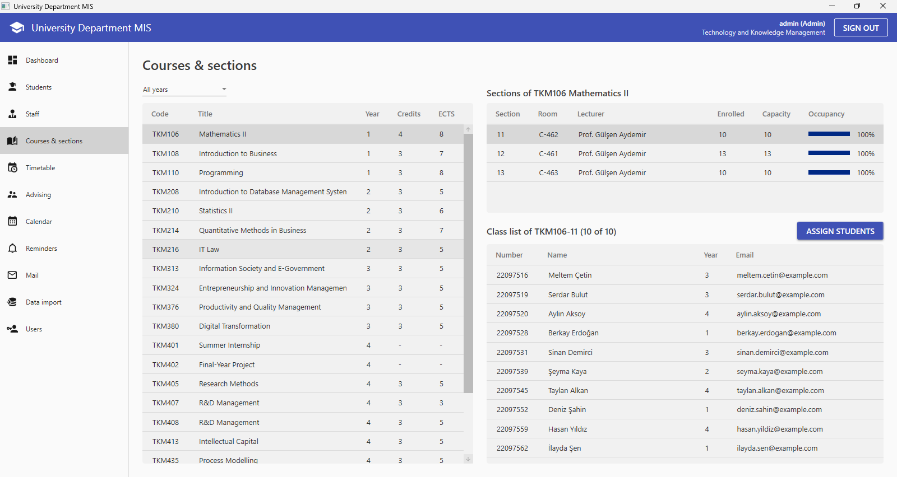
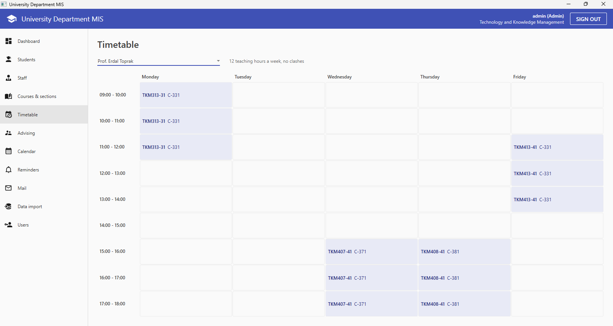
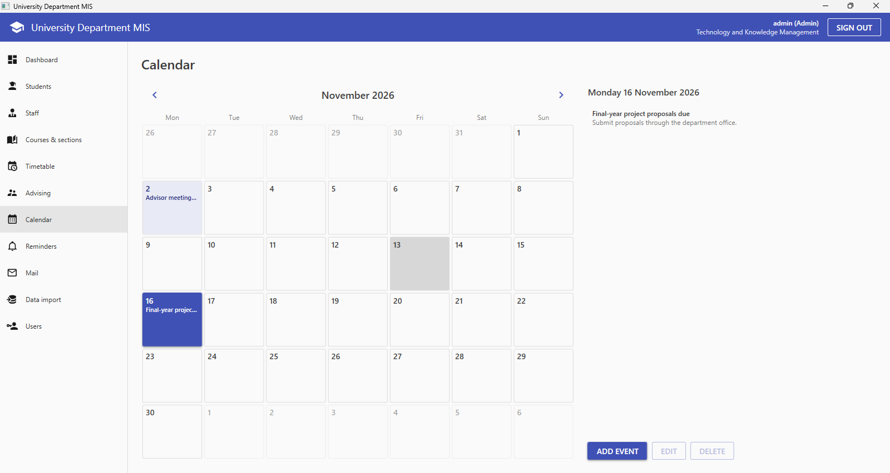
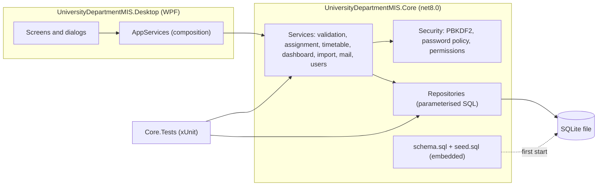
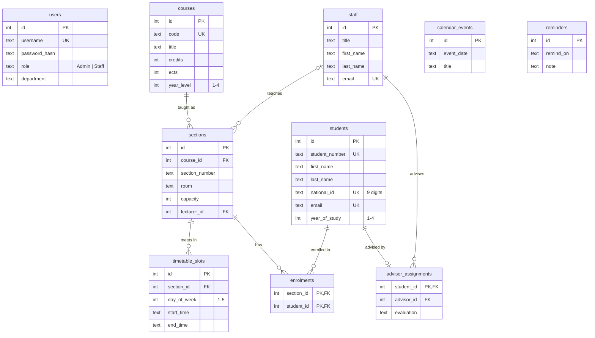

# University Department Management Information System

[](https://github.com/yasinttunc/university-department-management-information-system/actions/workflows/ci.yml)

A Windows desktop application for running an academic department: student records, staff workloads, courses and sections, timetables, advising and evaluations, a calendar with reminders, group email and Excel data import.

**C# · .NET 8 · WPF · SQLite · xUnit · GitHub Actions**

This project originated as a solo BSc final-year project in 2024, built with .NET Framework 4.7.2.

In 2026, I modernised it to .NET 8 with a normalised SQLite database, secure authentication, a testable core architecture, automated tests, CI, and a redesigned WPF interface.

I used Claude Code as an AI-assisted development tool during the modernisation process. I remained responsible for the project scope, architecture, data model, security decisions, reviewing implementation changes, debugging, testing, CI configuration, and final integration.



## Features

| Screen | What it does |
|---|---|
| Dashboard | Students by year, average section occupancy, advisees per advisor, evaluations still to record, next reminders and events |
| Students | Filter by year, search by name, number or email; add, edit and delete with validation (admin) |
| Staff | Sections, weekly teaching hours and advisees per person, with links to their timetable and advisees |
| Courses & sections | Occupancy per section, class lists, and random assignment that fills capacity without double-booking a student |
| Timetable | Monday to Friday, 09:00 to 18:00 grid per lecturer, with clashes highlighted |
| Advising | An advisor's students and their end-of-term evaluations, saved as you choose them |
| Calendar & reminders | Month view with events, plus dated reminders |
| Mail | Recipients by year or section, opened in the user's mail app as BCC, copied, or saved as CSV |
| Data import (admin) | Preview and import students from Excel; invalid and duplicate rows are reported with their row numbers |
| Users (admin) | Add accounts and reset passwords under the password policy |

Admins see every screen. Staff accounts see everything except *Data import* and *Users*, and view student records read-only.

<table>
  <tr>
    <td></td>
    <td></td>
  </tr>
  <tr>
    <td></td>
    <td></td>
  </tr>
</table>

Screenshots are taken by the CI smoke test on a GitHub-hosted Windows runner (`.github/workflows/screenshots.yml`).

## What changed from the 2024 version

| | 2024 | 2026 |
|---|---|---|
| Platform | .NET Framework 4.7.2, `packages.config` | .NET 8, SDK-style projects |
| Database | 171 tables across 11 SQLite files, one table per person or class section | 10 normalised tables in one file, with foreign keys and CHECK constraints |
| Passwords | Plain text, plus a hard-coded debug login | Salted PBKDF2-HMAC-SHA256 (600,000 iterations), constant-time comparison |
| SQL | Built by string concatenation, with table names spliced into queries | Constant SQL with every value bound as a parameter |
| Structure | One 1,220-line window class with the logic in event handlers | `Core` library (repositories and services) behind thin WPF screens |
| Layout | 200+ fixed pixel margins | `Grid` and `DockPanel` layouts that stretch with the window |
| Random assignment | Fixed student-number range and a new `Random()` in each loop iteration | Fisher-Yates shuffle over real students, capacity-aware, no student in two sections of a course |
| Language | Mixed Turkish and English | English throughout |
| Tests | None | 183 xUnit tests and a UI smoke test, run in CI on every push |

## Architecture



**The desktop app never touches SQL.** Screens call services and repositories in `Core`; repositories run fixed SQL statements with parameters. Everything in `Core` is covered by tests against a real SQLite database.

### Database



On first start the app creates `%LOCALAPPDATA%\UniversityDepartmentMIS\university.db` and loads the demo data. Set the `UDMIS_DB_PATH` environment variable to use a different file.

## Running it

Requirements: Windows and the [.NET 8 SDK](https://dotnet.microsoft.com/download/dotnet/8.0).

```
git clone https://github.com/yasinttunc/university-department-management-information-system.git
cd university-department-management-information-system
dotnet run --project src/UniversityDepartmentMIS.Desktop
```

Demo accounts (demo data only; the database stores just their PBKDF2 hashes):

| Username | Password | Role |
|---|---|---|
| `admin` | `Admin2026` | Admin |
| `staff` | `Staff2026` | Staff |

## Tests and CI

```
dotnet test
```

The tests cover the core library only, and each test gets its own temporary SQLite file built from the real schema and demo data, so there are no database mocks. Excel test files are generated in memory.

GitHub Actions runs on every push and pull request:

- **Build and test** on `windows-latest`; the test count is reported on the run.
- **UI smoke test** (`tools/smoke-test.ps1`): starts the built app on a fresh database, checks the wrong-password message, signs in as both demo users through UI Automation, opens all eleven screens and the new-student dialog, checks row counts and the role-based menu, and fails on any error dialog.
- **Content checks** (`tools/check_content.py`): no Turkish text in source code, no files over 1 MB, and no banned words (names removed during anonymisation are checked by SHA-256 hash, so the list reveals nothing).

## Project structure

```
src/
  UniversityDepartmentMIS.Core/        models, database, repositories, services, security
  UniversityDepartmentMIS.Desktop/     WPF app: App, MainWindow, Views/Screens, Views/Dialogs
tests/
  UniversityDepartmentMIS.Core.Tests/  xUnit tests
tools/                                 CI scripts
docs/screenshots/                      images used in this README
```

## Data notice

All people and records in the demo data are fictional. National IDs are random nine-digit numbers, email addresses use `example.com`, and phone numbers use a range reserved for drama. Names of real staff, contact details and institutional branding were removed before publication.

## License

[MIT](LICENSE). Uses [MaterialDesignInXamlToolkit](https://github.com/MaterialDesignInXAML/MaterialDesignInXamlToolkit), [ClosedXML](https://github.com/ClosedXML/ClosedXML) and [Microsoft.Data.Sqlite](https://github.com/dotnet/efcore), all MIT-licensed.
